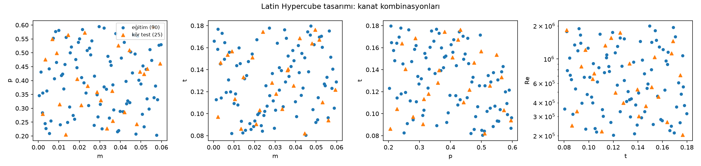
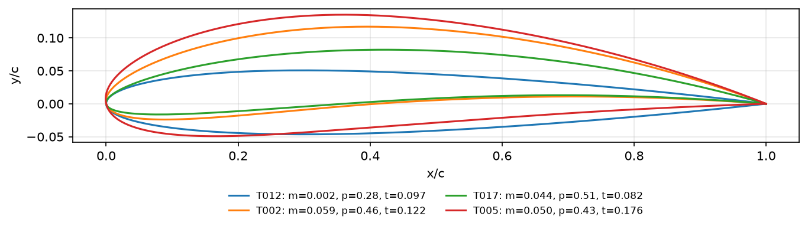
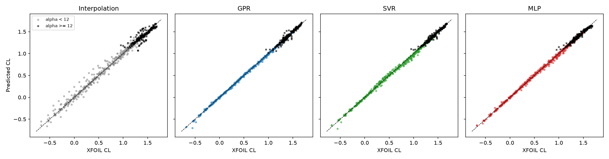
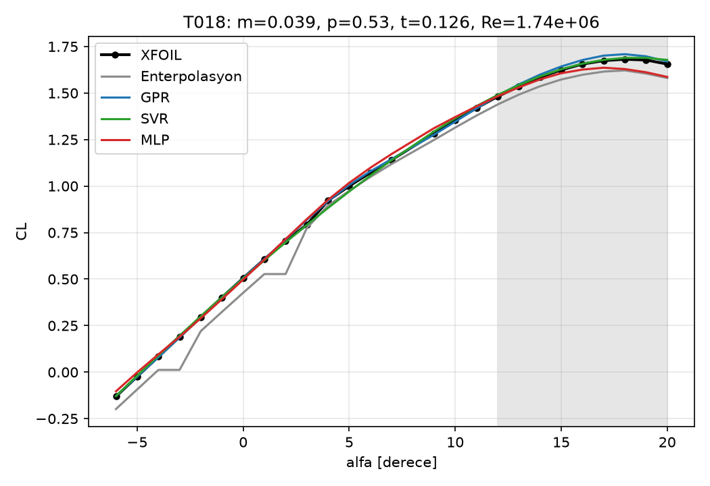
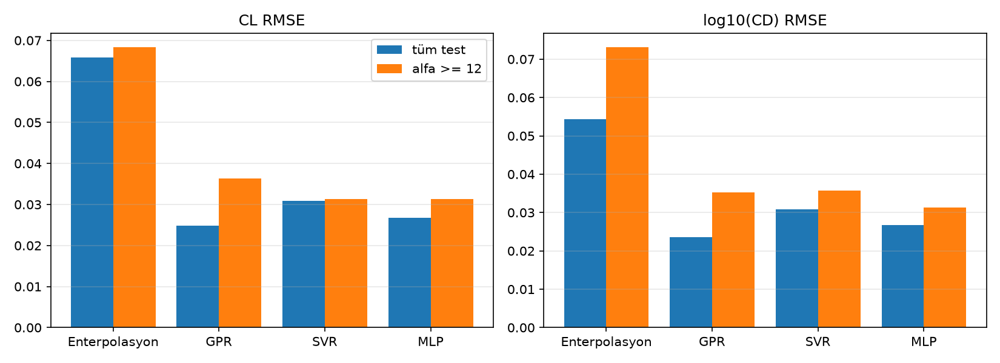
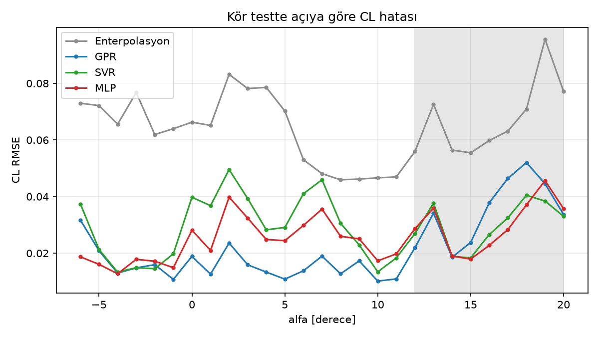
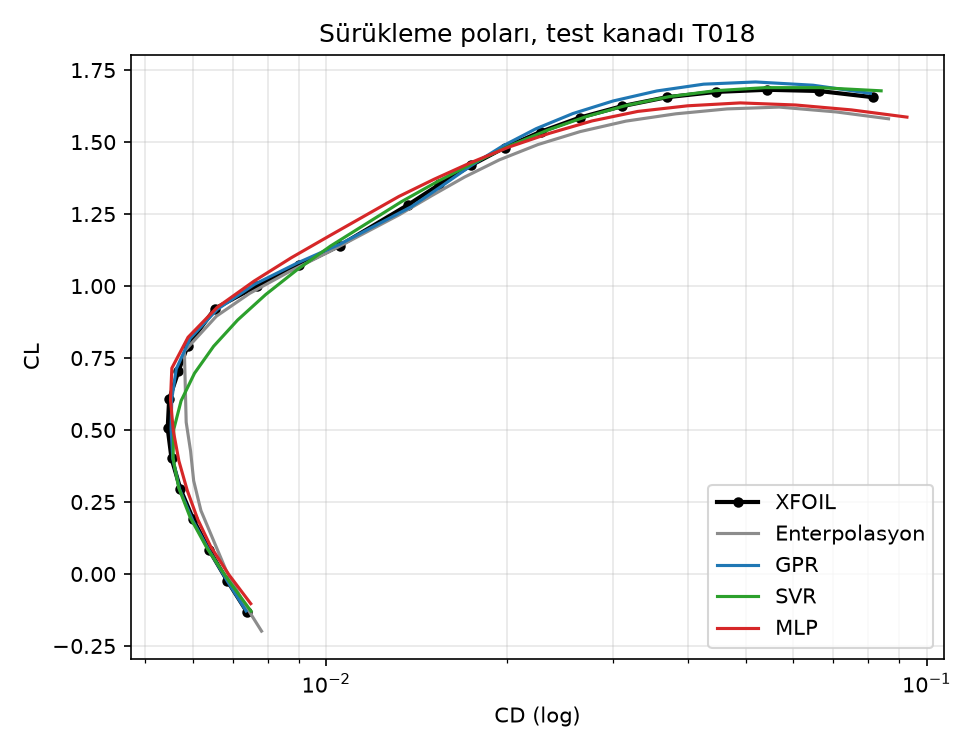

# Aerodinamik Vekil Model: NACA 4 Hane Kanat Profilleri

XFOIL ile bir kanadın tek bir açıdaki CL ve CD değerini hesaplamak saniyenin kesirleri ile saniyeler arasında sürüyor. Tasarım taramasında yüz binlerce nokta gerektiğinde bu yavaş kalıyor. Bu projede XFOIL'den bir veri tabanı ürettim, bu veriyle üç vekil model eğittim ve modelleri eğitimde hiç görmedikleri kanatlar üzerinde doğrusal enterpolasyonla karşılaştırdım.

- Girdiler: kamber `m`, kamber konumu `p`, kalınlık `t`, Reynolds sayısı `Re`, hücum açısı `alfa`
- Çıktılar: `CL` ve `CD`
- Modeller: Gauss Süreç Regresyonu (GPR), Destek Vektör Regresyonu (SVR), çok katmanlı algılayıcı (MLP)
- Referans: doğrusal enterpolasyon

## Yöntem

**Geometri.** NACA 4 hane profilleri kendi yazdığım üreteçle oluşturuluyor (`src/geometri.py`). Kord boyunca kosinüs aralıklı 100 nokta kullanılıyor ve koordinatlar Selig sırasında. Kalınlık formülünde kapalı art kenar katsayısı (−0,1036) kullanılıyor. AeroSandbox'ın NACA 2412'si ile en büyük fark 1,27e-3 çıktı. Farkın tamamı art kenarda ve AeroSandbox'ın açık art kenarlı formülünden (−0,1015) geliyor: x = 1'deki yarı kalınlık farkı tam olarak `5 · 0,12 · 0,0021 = 1,26e-3`.

**Deney tasarımı.** Latin Hypercube ile 4 boyutlu örnekleme yapıldı (`src/tasarim.py`):

| Girdi | Aralık |
|---|---|
| m | 0 – 0,06 |
| p | 0,2 – 0,6 |
| t | 0,08 – 0,18 |
| log10(Re) | 5,3 – 6,3 |

Eğitim için 90, kör test için 25 kanat farklı tohumlarla üretildi. Hücum açısı −6° ile 20° arasında 1° adımla taranıyor (27 açı). İki kümede ortak kimlik ya da ortak geometri olmadığı kodla kontrol ediliyor (`src/hazirlik.py`).

**Veri üretimi.** `src/veri_uret.py` her kanat için iki ayrı XFOIL taraması yapıyor: 0°'den 20°'ye ve 0°'den −6°'ya. Tek taramada −6°'dan 20°'ye gitmek yakınsamayı bozabiliyor. Koşular paralel çalıştığı için her kanada benzersiz bir ad veriliyor. XFOIL açıyı yuvarlayarak yazdığından sonuçlar istenen açıyla 0,01° toleransla eşleştiriliyor. NaN, `CD <= 0` ya da `|CL| > 3` olan satırlar atılıyor.

**Girdi ve çıktı.** Özellikler `[m, p, t, log10(Re), alfa]` ve hepsi tasarım aralıklarına göre [0, 1]'e ölçekleniyor. Ölçek sınırları tasarımdan geliyor, test verisine bakılmıyor. Hedefler `CL` ve `log10(CD)`. CD birkaç büyüklük mertebesine yayıldığı için logaritması modelleniyor ve tahminden sonra `10 ** tahmin` ile geri dönülüyor.

**Modeller** (`src/modeller.py`):

- **Enterpolasyon:** `LinearNDInterpolator` kullanılıyor. Dış bükey zarfın dışında kalan noktalarda `NearestNDInterpolator` devreye giriyor.
- **GPR:** Çekirdek `Constant × Matern(ν = 2,5, girdi başına ayrı uzunluk ölçeği) + White`, `normalize_y=True`. Hiperparametreler rastgele seçilen 750 noktalık bir alt kümede öğreniliyor, sonra öğrenilen çekirdekle tüm veriye `optimizer=None` ile yeniden oturtuluyor. CL ve log10(CD) için ayrı modeller var.
- **SVR:** RBF çekirdek, hedef `StandardScaler` ile ölçekleniyor. `C`, `gamma` ve `epsilon` için ızgara araması `GroupKFold(5)` ile yapılıyor. Gruplar kanat kimliği, böylece aynı kanadın komşu açıları hem eğitime hem doğrulamaya girmiyor. Puanlama RMSE.
- **MLP:** Katmanlar `(128, 128, 64)`, ReLU, `early_stopping=True`. İki çıkışlı tek ağ kullanılıyor ve 5 farklı tohumla eğitilen ağların ortalaması alınıyor. `early_stopping` doğrulama kümesini rastgele satırlardan ayırdığı için durdurma kararında küçük bir sızıntı var. Değerlendirme kör testle yapıldığından sonuçları etkilemiyor.

## Veri

| Küme | Kanat | İstenen satır | Elenen | Kalan |
|---|---|---|---|---|
| Eğitim (`data/egitim.csv`) | 90 | 2430 | 132 (%5,4) | 2298 |
| Kör test (`data/kor_test.csv`) | 25 | 675 | 28 (%4,1) | 647 |

Elenen satırların hepsi XFOIL'in yakınsamadığı noktalar. `CD <= 0` ya da `|CL| > 3` olduğu için atılan satır yok. Eğitimde elenen 132 satırın 51'i 18–20° aralığında, yani yakınsama sorunu beklendiği gibi stall sonrasında yoğunlaşıyor. Sayılar `data/uretim_ozeti.json` dosyasında.

Veri üretim hattı önce bilinen profillerle kontrol edildi (`src/buyukluk_kontrol.py`, Re = 1e6):

| | CL(0°) | CL(5°) | CLmax | En düşük CD |
|---|---|---|---|---|
| NACA 0012 | 0,000 | 0,544 | 1,315 (16°) | 0,00533 |
| NACA 2412 | 0,226 | 0,843 | 1,433 (17°) | 0,00539 |

## Sonuçlar

Dört yöntem aynı 647 kör test satırında değerlendirildi (`results/sonuclar.csv`). Stall bölgesi `alfa >= 12` olarak alındı.

| Yöntem | CL RMSE | CL MAE | CL R² | log10(CD) RMSE | CD bağıl hata | Stall CL RMSE | Stall log10(CD) RMSE |
|---|---|---|---|---|---|---|---|
| Enterpolasyon | 0,0658 | 0,0413 | 0,9879 | 0,0544 | %7,3 | 0,0684 | 0,0732 |
| GPR | **0,0248** | **0,0148** | **0,9983** | **0,0236** | **%3,1** | 0,0364 | 0,0352 |
| SVR | 0,0309 | 0,0211 | 0,9973 | 0,0308 | %4,9 | **0,0313** | 0,0358 |
| MLP | 0,0268 | 0,0194 | 0,9980 | 0,0268 | %4,3 | **0,0313** | **0,0314** |

Hesap maliyeti:

| Yöntem | Eğitim süresi | 1000 nokta tahmin süresi |
|---|---|---|
| Enterpolasyon | 20,9 s | 10,5 s |
| GPR | 51,3 s | 0,16 s |
| SVR | 485,7 s (ızgara araması dahil) | 0,14 s |
| MLP | 8,4 s (5 ağ) | 0,005 s |
| XFOIL | – | ≈ 637 s |

XFOIL süresi, veri üretimi sırasında süreç başına ölçülen nokta başı süreden (0,64 s, iki tarama dahil) hesaplandı. Ölçüm paralel koşu yükü altında yapıldığı için kaba bir değer.

**Yorum:**

- **Genel tablo:** Üç model de enterpolasyondan belirgin şekilde iyi. CL RMSE 2,1–2,7 kat, CD bağıl hatası 1,5–2,4 kat daha düşük. Genel doğrulukta en iyisi GPR.
- **Stall bölgesi:** GPR'ın stall CL hatası (0,0364), genel hatasının (0,0248) yaklaşık 1,5 katı. Stall'da SVR ve MLP biraz daha iyi (0,0313). Stall tepesinden sonra CL'nin aniden kırılması, düzgün bir Matern çekirdeği için daha zor bir şekil.
- **Enterpolasyonun zayıflığı:** Test noktalarının %59,5'i eğitim noktalarının dış bükey zarfının dışında kalıyor. 5 boyutta 90 kanatla zarf, tasarım uzayının küçük bir kısmını kaplıyor ve bu noktalarda en yakın komşu kullanılıyor. `results/cl_alfa_test_kanadi.png` grafiğindeki basamaklar bundan geliyor. Enterpolasyonun zayıf çıkmasının ana nedeni bu.
- **SVR ızgara araması** CL için `C = 100, gamma = 1, epsilon = 0,01`, log10(CD) için `C = 1000, gamma = 1, epsilon = 0,01` seçti. Gruplu çapraz doğrulama RMSE değerleri sırasıyla 0,0378 ve 0,0342. log10(CD) için seçilen `C` ızgaranın üst sınırında, ızgara genişletilirse biraz daha iyi sonuç çıkabilir.
- **Hız:** Eğitilmiş modellerin hepsi 1000 noktayı saniyenin altında tahmin ediyor. Aynı iş XFOIL'de yaklaşık on dakika sürüyor.

### GPR uzunluk ölçekleri

Ölçekli [0, 1] girdi uzayında öğrenilen değerler (`results/gpr_uzunluk_olcekleri.csv`):

| Girdi | CL | log10(CD) |
|---|---|---|
| m | 1,40 | 1,42 |
| p | 1,90 | 1,53 |
| t | 1,43 | 1,28 |
| log10(Re) | 2,04 | 1,98 |
| alfa | **0,42** | **0,31** |

Küçük uzunluk ölçeği, çıktının o girdiyle daha hızlı ve daha az doğrusal değiştiğini gösteriyor. CL'yi en çok etkileyen girdi açıkça hücum açısı. Geometri girdileri arasında kamber ve kalınlık, kamber konumundan daha etkili. Re en uzun ölçeğe sahip, yani bu aralıkta CL'yi en az etkileyen girdi. CD tarafında da açı başta, ardından kalınlık geliyor.

Uzunluk ölçeği bir duyarlılık ölçüsü ama tam olarak etki büyüklüğü değil. Bir girdinin etkisi büyük ama doğrusalsa, o girdi için de uzun bir ölçek öğrenilebilir. Örneğin kamberin CL'yi kaydırma etkisi büyük ama neredeyse doğrusal.

## Grafikler

Tüm grafikler `src/grafikler.py` ile gerçek XFOIL verisinden ve kör test tahminlerinden üretiliyor.

`results/tasarim_uzayi.png`: eğitim ve kör test kanatlarının tasarım uzayındaki yeri. Test kanatları aynı aralıkta ama eğitim noktalarıyla çakışmıyor.



`results/ornek_profiller.png`: kamberi ve kalınlığı en uçta olan birkaç test kanadı, `src/geometri.py` ile çizildi.



`results/cl_tahmin_gercek.png`: her yöntem için tahmin ve XFOIL CL değerleri, stall noktaları ayrı işaretli.



`results/cl_alfa_test_kanadi.png`: tepe CL'si en yüksek test kanadı (T018) için CL–alfa eğrisi, gri alan stall bölgesi.



`results/rmse_karsilastirma.png`: tüm test noktaları ve yalnızca stall bölgesi için RMSE.



`results/aciya_gore_hata.png`: her açı için kör test CL RMSE. GPR 12°'nin altında hemen her açıda en düşük hatayı veriyor. 15–18° arasında ise üç model içinde en yüksek hata onda, 18°'de 0,052'ye çıkıyor. GPR'ın stall RMSE değerinin SVR ve MLP'den kötü çıkmasının nedeni bu. Enterpolasyon bütün açılarda en yüksek hatayı veriyor.



`results/surukleme_polari.png`: aynı test kanadı için CL–CD poları. Modeller en düşük sürüklemenin olduğu bölgeyi de stall'a doğru artışı da yakalıyor. Enterpolasyonun 0,5 civarındaki kayması zarf dışı en yakın komşu tahmininden geliyor.



## Sınırlamalar

- XFOIL iki boyutlu, viskoz bir panel yöntemidir ve CFD'nin yerini tutmaz. Düşük Mach sayıları için geçerlidir. Bütün veri `mach = 0` ve `n_crit = 9` ile üretildi.
- Stall bölgesinde XFOIL'in kendisi de daha az güvenilirdir (ayrılmış akış, yakınsama sorunları). Elenen noktaların çoğu da bu bölgede.
- Modeller yalnızca örneklenen tasarım aralığında geçerlidir. Kör test kanatları aynı aralığın içinde. Bu bir ekstrapolasyon testi değil.
- Veri sentetiktir, gerçek ölçüm içermez.
- Kör test 25 kanattan oluşuyor. GPR ile MLP arasındaki fark küçük (CL RMSE 0,0248 ve 0,0268), farklı bir test kümesinde sıralama değişebilir.
- Elenen noktalar boşluk olarak kalıyor. Yakınsamayan açıların yerine bir değer uydurulmuyor.

## Yeniden üretme

Windows ve Python 3.12 ile:

```powershell
py -3.12 -m venv .venv
.venv\Scripts\Activate.ps1
python -m pip install -r requirements.txt
```

XFOIL 6.99'u indirip `bin/xfoil.exe` olarak yerleştirin:

```powershell
New-Item -ItemType Directory -Force bin | Out-Null
Invoke-WebRequest -Uri "https://web.mit.edu/drela/Public/web/xfoil/XFOIL6.99.zip" -OutFile "bin\XFOIL6.99.zip"
Expand-Archive "bin\XFOIL6.99.zip" -DestinationPath "bin\xfoil_zip"
Copy-Item "bin\xfoil_zip\xfoil.exe" "bin\xfoil.exe"
```

Sonra sırasıyla:

```powershell
python src\kurulum_kontrol.py    # NACA 2412, Re = 1e6, alfa = 5 derece: CL ≈ 0,81
python src\geometri_kontrol.py   # kendi geometrimiz ile AeroSandbox karşılaştırması
python src\buyukluk_kontrol.py   # NACA 0012 ve 2412 büyüklük kontrolleri
python src\veri_uret.py          # data/egitim.csv, data/kor_test.csv (yaklaşık 3-4 dakika)
python src\hazirlik.py           # sızıntı kontrolü
python src\degerlendir.py        # modeller ve kör test (yaklaşık 10 dakika)
python src\grafikler.py          # results/*.png
```

Süreler kullanılan makineye göre değişir. XFOIL paralel koşuda çekirdek sayısının iki eksiği kadar süreç kullanır.

## Klasör yapısı

```
src/        kaynak kodlar
data/       egitim.csv, kor_test.csv, uretim_ozeti.json
results/    sonuç tabloları ve grafikler
bin/        xfoil.exe (depoya dahil değil)
```
